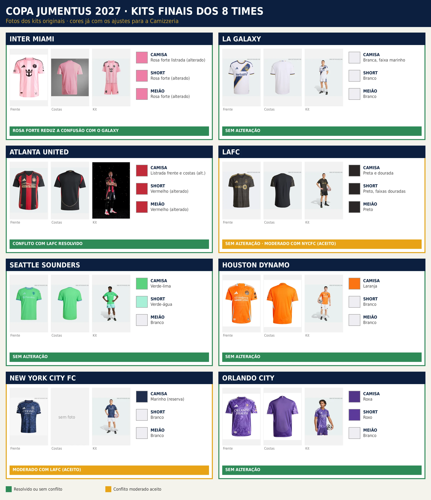

<p align="center">
  
</p>

<h1 align="center">Copa Jumentus 2027 — Sistema de Sorteio</h1>

<p align="center">
  Sorteio balanceado dos times da Copa Jumentus, com cerimônia de revelação jogador por jogador e link de resultado para a galera.<br>
  16 e 17 de janeiro de 2027 · Instagram <a href="https://instagram.com/c.r.jumentus">@c.r.jumentus</a>
</p>


## O que o sistema faz

1. **Lê os inscritos** da planilha oficial (Google Sheets, aba `INSCRITOS`).
2. **Sorteia os jogadores de linha** entre 8 times de capitães fixos, equilibrando a soma de estrelas (diferença máxima de 2 entre o time mais forte e o mais fraco).
3. **Sorteia os goleiros** em etapa separada, 1 por time. Estrelas de goleiro não contam.
4. **Conduz a cerimônia**: o operador revela um jogador por vez (clique, espaço ou Enter), com a tela projetada.
5. **Gera um link de resultado** (`/resultado/...`) que abre no celular sem precisar de servidor.

As regras completas estão em [CLAUDE.md](CLAUDE.md) §3, que é a fonte de verdade do projeto.

## Times

| Time | Kit |
|---|---|
| Inter Miami | rosa forte em todas as peças |
| LA Galaxy | sem alteração |
| LAFC | sem alteração |
| Seattle Sounders | meião branco |
| Atlanta United | listras frente e costas, short e meião vermelhos |
| New York City FC | reserva marinho, short branco, meião branco |
| Houston Dynamo | meião branco |
| Orlando City | meião branco |



## Como rodar

Requer Node 20+.

```bash
npm ci
npm run dev        # http://localhost:3100
npm test           # testes do domínio (Vitest)
```

Sem cadastro importado, o site usa um elenco de exemplo.

## Carregar os inscritos da planilha

1. Preencha a aba **INSCRITOS** da planilha de sorteio:
   - **Posição**: GOL, ZAG, MEI ou ATA
   - **Estrelas**: 1 a 6 (goleiro pode ficar vazio)
   - **Capitão do time**: o nome do time, só na linha do capitão (1 por time)
   - **Status**: `Confirmado` entra no sorteio; `Lista de espera` fica de fora
2. Importe a aba para `dados/inscritos.csv`:

   ```bash
   npm run importar -- "https://docs.google.com/spreadsheets/d/<ID>/export?format=csv&gid=2002"
   ```

   Esse link exige que a planilha esteja aberta para quem tiver o link, o que deixa as estrelas visíveis. Para evitar isso, baixe a aba em **Arquivo › Fazer download › CSV** e salve como `dados/inscritos.csv`.
3. Abra o site. Se faltar alguma informação, a home lista as pendências e o botão de sorteio fica bloqueado até a planilha ser corrigida e importada de novo.

Formato de referência: [`dados/inscritos.example.csv`](dados/inscritos.example.csv). A pasta `dados/` não é versionada.

## Depois do sorteio

Cole os elencos finais em **TIMES › Times Definidos** na planilha de sorteio. A planilha de uniformes puxa os nomes dali automaticamente.

## Estrutura

```
src/
  lib/
    config.ts        # constantes de regra (tolerância, tentativas, escala de estrelas)
    domain/          # tipos, sorteio e validação — puro e testado
    repo/            # cadastro: planilha (CSV) ou seed de exemplo
    share/           # codificação do link de resultado
  app/               # rotas: / · /cerimonia · /resultado/[payload]
  components/        # UI (HUD cards, estrelas, wordmark)
scripts/
  importar-planilha.mjs
public/
  banner-copa-jumentus.webp
  imagens/           # logo, uniformes, escudos, artes — ver public/imagens/README.md
docs/
  marca/             # manual de marca e skill do Gemini
dados/               # inscritos.csv local (fora do Git)
```

## Identidade visual

- Identidade híbrida: estrutura MLS com atmosfera Vice City. Regras em [`docs/marca/`](docs/marca/) (manual de marca e skill do Gemini).
- A logo oficial fica em [`public/imagens/logo/`](public/imagens/logo/) e não deve ser redesenhada.
- O visual do site segue o design system descrito em CLAUDE.md §5.
- O wordmark "COPA JUMENTUS / VICE CITY" é SVG vetorizado. **A fonte Pricedown nunca entra no repositório** (restrição de licença).

## Stack

Next.js 15 (App Router) · React 19 · TypeScript strict · Tailwind CSS 3 · Vitest
